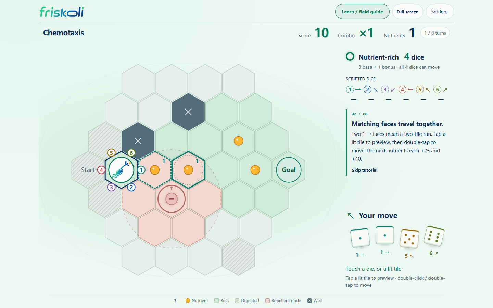

# Friskoli Chemotaxis

[](LICENSE)

A single-player, bilingual board game about movement under changing environmental signals. Roll direction dice, collect nutrients, build a Combo, and reach the goal before the turn budget runs out.

**Part of Friskoli, developed for the SZU-SIAT iGEM 2026 project and maintained by [SZU-SIAT-iGEM](https://github.com/SZU-SIAT-iGEM).** Version **1.0.0** is the first stable public release.



## Why we built it

Chemotaxis is movement influenced by chemical signals in the surrounding environment. This game gives visitors at outreach activities a small, playable way to explore that idea: nutrients and repellents change the chances of each direction, while the player chooses how to use the roll. The tension between feeding, taking a detour, and finishing makes the effect of local signals visible.

The board, dice probabilities, and cell types are educational game abstractions. Their numerical values are designed for play; they are not measurements or predictions of bacterial behavior. The goal does not attract the cell in the probability model.

## Play

Download **`friskoli-chemotaxis-v1.0.0.html`** from the [stable release](https://github.com/SZU-SIAT-iGEM/friskoli-chemotaxis/releases/latest) and open it in a modern browser. The file includes the application, artwork, and both language packs; playing requires no installation or internet connection.

1. Choose **Learn on the board · 6 steps** for the interactive tutorial, or **Start playing** for a quick game.
2. Tap the dice, or drag them and release, to roll.
3. Tap a highlighted tile to preview the full run and score. Double-click it, or tap the same tile twice in quick succession, to move. The explicit confirmation control is also available.
4. Collect orange nutrients and reach the goal. Matching dice always move as one group.

The game opens in **English by default** and remembers your language choice. Use the Chinese language control in **Settings** for Simplified Chinese. A URL ending in `?lang=en` or `?lang=zh-CN` overrides the saved language. Open **Learn / field guide** at any time for object explanations and rules.

Read the [usage guide](docs/USAGE.md) for controls and local records, and the [game rules](docs/RULES.md) for movement, terrain, probability, and scoring.

## Features

- A fixed 37-tile quick game, plus seeded 127- and 217-tile maps.
- Six direction dice with live probabilities based on the cell's current location.
- Nutrient bonuses, depleted terrain, repellent cancellation, and wall collisions.
- Combo scoring, food-assisted extra actions, and a finish bonus.
- Six tutorial steps using the same movement and scoring functions as regular games.
- Mouse, touch, and keyboard controls; pan and pinch-to-zoom on larger boards.
- Day and night themes, reduced-motion support, and optional fullscreen.
- Local score records, JSON export, and import/export of translation packs.
- A single-file offline build with no backend, account, analytics, or remote leaderboard.

## Run from source

Use **Node.js 22.12 or newer** and npm. The supplied CI template uses Node.js 24.

```sh
git clone https://github.com/SZU-SIAT-iGEM/friskoli-chemotaxis.git
cd friskoli-chemotaxis
npm ci
npm run dev -- --host 127.0.0.1
```

Open the local URL printed by Vite. For an English interface, append `?lang=en`.

```sh
npm run verify
npx playwright install chromium
npm run test:browser
npm run release:package
```

`verify` runs TypeScript checks, rule and gesture-geometry tests, validation of 2,200 seeded maps, and the production build. Browser checks start their own local server and cover the tutorial, complete games, responsive layouts, animation, emulated touch, and offline play. Release packaging produces the standalone HTML file and a source ZIP in `output/release/`. A [CI template](.github/ci-template.yml) is provided; see [Development](docs/DEVELOPMENT.md#continuous-integration) to enable it.

## Documentation and contributing

| Document | Purpose |
| --- | --- |
| [Usage](docs/USAGE.md) | Setup, controls, settings, records, and troubleshooting |
| [Rules](docs/RULES.md) | Complete rules for the stable release |
| [Development](docs/DEVELOPMENT.md) | Architecture, state transitions, validation, and release procedure |
| [Contributing](CONTRIBUTING.md) | Bug reports, changes, and pull requests |
| [Security](SECURITY.md) | Reporting a vulnerability privately |
| [Third-party notices](THIRD_PARTY_NOTICES.md) | Dependencies and artwork attribution |

Report reproducible problems through [GitHub Issues](https://github.com/SZU-SIAT-iGEM/friskoli-chemotaxis/issues). Include the browser, screen size, selected map and seed, and steps to reproduce. Code comments and project documentation are written in English; player-facing translations remain bilingual.

## Compatibility and data

Use a current desktop or mobile browser with JavaScript, SVG, and Pointer Events support. Fullscreen availability and local file storage vary by browser. The game remains playable if persistent storage is unavailable; export records before closing the page when you need to keep them. Refreshing the page starts a new session rather than restoring an unfinished game.

Automated browser checks cover desktop, phone portrait, phone landscape, and tablet viewport sizes in Chromium, including simulated touch gestures. Physical device testing and a full Safari/Firefox validation are still needed. Map connectivity checks ensure a geometric route exists; dice randomness means a particular game can still end without reaching the goal.

## License and attribution

Source code and project documentation are available under the [MIT License](LICENSE). Friskoli artwork and identifiers have separate terms in [the asset notice](src/assets/NOTICE.md); the MIT license does not grant rights to those assets or imply team endorsement. Dependency licenses remain with their respective authors.
